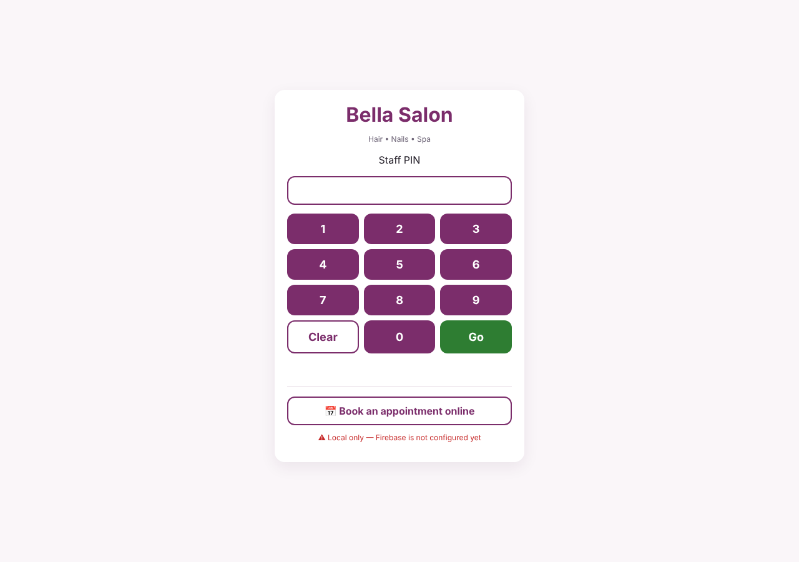
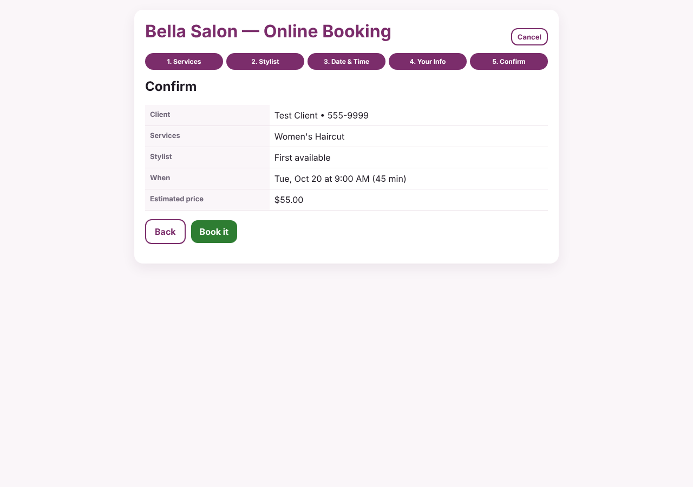
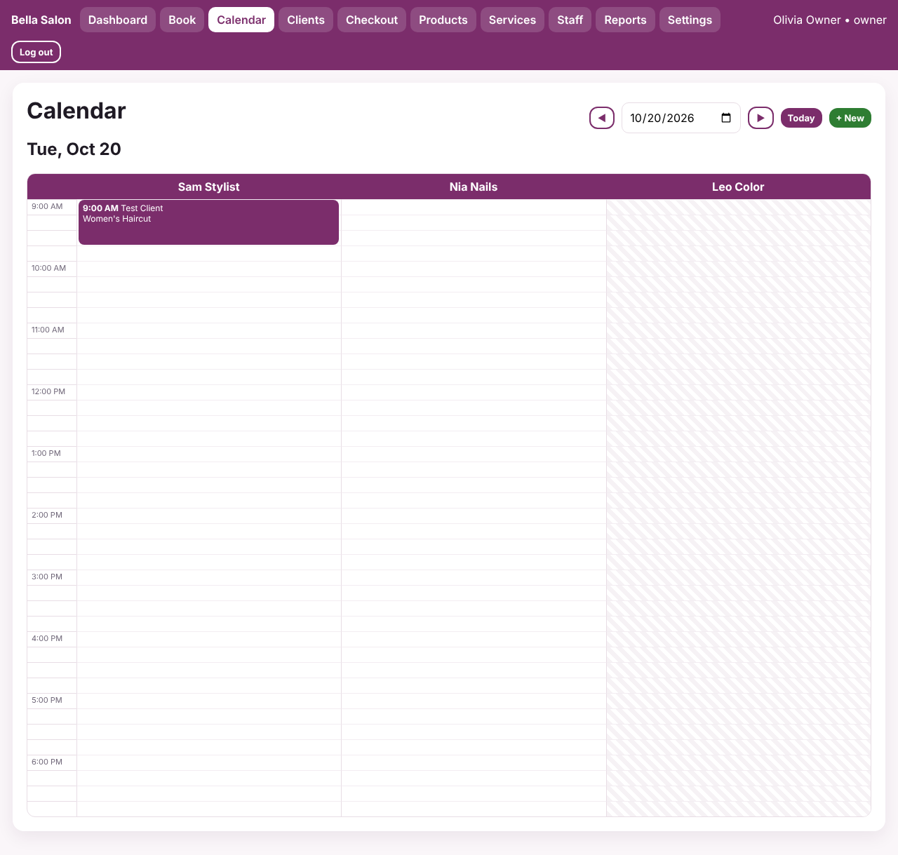
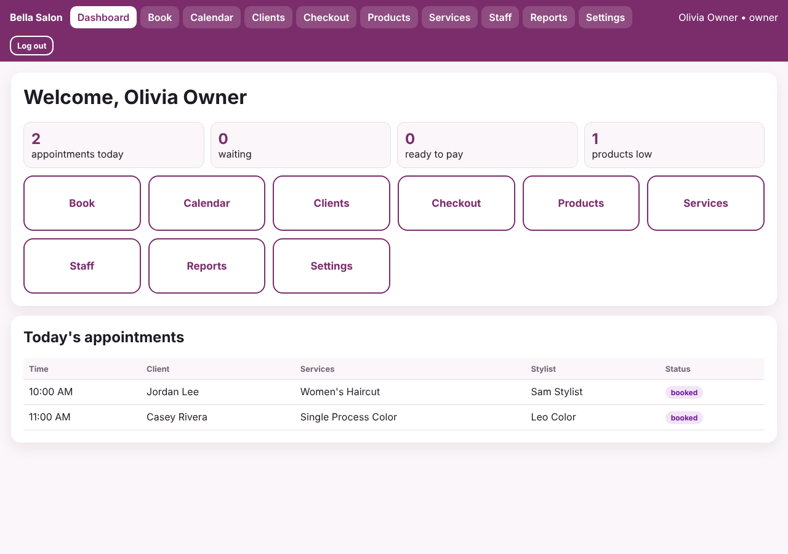
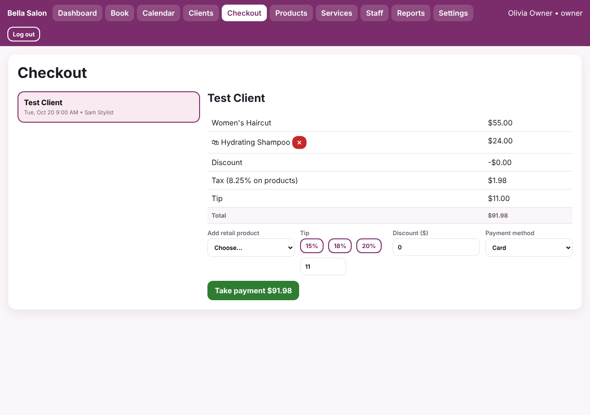
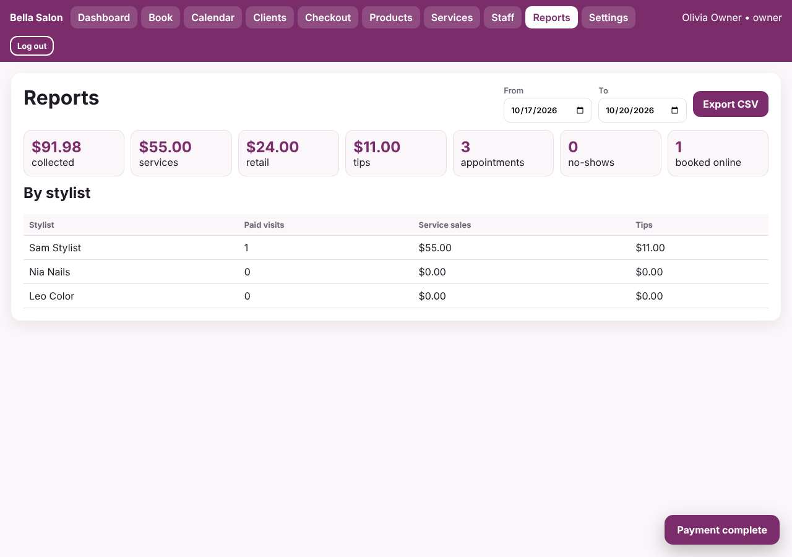

# How to Build a Salon Booking System (the Guthrie RMS Way)

This guide teaches you how to build a salon booking website using the same approach as **Guthrie RMS**, the restaurant management system in this repository. By the end you will have a site where:

- **Clients** book online. They pick services, a stylist, and an open time.
- **The front desk** books walk-ins and phone calls, manages clients, checks people in, and takes payment.
- **Stylists** log in with a PIN and see their own day.
- **The owner** manages services, staff schedules, retail products, settings, and reports.

There is a **working starter app** in [`starter/`](starter/). Every section below refers to a numbered `STEP` comment in [`starter/app.js`](starter/app.js), so you can read the explanation and the real code side by side. **Get the starter running first (Part 2), then work through the guide, then pick up the build-out roadmap (Part 7).**

| | |
|---|---|
| **Who this is for** | Someone comfortable with basic HTML, CSS, and JavaScript (variables, functions, arrays, objects). No frameworks needed. |
| **Time** | About 1–2 days to read and understand the starter. The roadmap items take longer. |
| **Tools** | A code editor (VS Code recommended), a web browser, Git, and a GitHub account. Python or the VS Code "Live Server" extension to run it locally. |

---

## Contents

- [Part 1 — How Guthrie RMS is built (and why we copy it)](#part-1--how-guthrie-rms-is-built-and-why-we-copy-it)
- [Part 2 — Get the starter running](#part-2--get-the-starter-running)
- [Part 3 — The foundation: data, saving, rendering](#part-3--the-foundation-data-saving-rendering)
- [Part 4 — The booking engine](#part-4--the-booking-engine)
- [Part 5 — Running the salon day](#part-5--running-the-salon-day)
- [Part 6 — Sharing data between devices and going live](#part-6--sharing-data-between-devices-and-going-live)
- [Part 7 — Build-out roadmap (what to build next)](#part-7--build-out-roadmap-what-to-build-next)
- [Part 8 — Testing checklist](#part-8--testing-checklist)
- [Appendix — Troubleshooting and glossary](#appendix--troubleshooting-and-glossary)

---

## Part 1 — How Guthrie RMS is built (and why we copy it)

Guthrie RMS is a **single-page app with no build step**. It's just three files served by GitHub Pages:

| File | What it does in Guthrie RMS | What it does in the salon app |
|---|---|---|
| `index.html` | An empty `<div id="app">` plus script tags | Same |
| `app.js` | All data, screens, and logic | Same, with salon screens |
| `styles.css` | All styling, with colors as CSS variables | Same, with a salon palette |
| `firebase-sync.js` | Optional: shares data across devices with Firebase | Same idea, simplified |

The whole app follows one loop:

```
 user clicks a button
        │
        ▼
 a window.someAction() function changes the `db` object
        │
        ▼
 save()   → writes db to localStorage (and to the cloud, if sync is on)
        │
        ▼
 render() → rebuilds the screen from db + state using template strings
```

This is the most important idea in the whole guide. **The screen is never edited directly.** You change the data, then redraw everything from the data. That keeps the screen and the data from ever disagreeing.

The restaurant and salon apps map onto each other almost one-to-one:

| Restaurant (Guthrie RMS) | Salon |
|---|---|
| Menu items | Services (with a **duration**) |
| Tables / orders | Appointments |
| Students and managers with PINs | Stylists, front desk, and owner with PINs |
| Shift scheduler | Stylist work days |
| KMS ticket stages (sent → ready) | Appointment status (booked → checked-in → in-service → completed) |
| Checkout center | Checkout (services + retail + tip + tax) |
| Inventory with pars | Retail products with pars |
| Reports + CSV export | Reports + CSV export |
| Theme & appearance settings | Same |

The one genuinely new thing a salon needs is **time-slot availability**: working out when a stylist is free. Part 4 covers it in detail.

---

## Part 2 — Get the starter running

1. **Get the files.** Clone this repository and open `guides/salon-booking/starter/`, or copy that folder into a new repository of its own (recommended for the real project, see [Part 6](#part-6--sharing-data-between-devices-and-going-live)).
2. **Serve it locally.** Browsers block some features on `file://` pages, so use a tiny local server:
   ```bash
   cd guides/salon-booking/starter
   python3 -m http.server 8000
   ```
   Then open <http://localhost:8000>. (Alternatively, in VS Code right-click `index.html` → **Open with Live Server**.)
3. **Log in with a demo PIN:**

   | PIN | User | Role |
   |---|---|---|
   | `9999` | Olivia Owner | owner (sees everything) |
   | `1111` | Fran FrontDesk | front desk |
   | `2001` | Sam Stylist | stylist (hair) |
   | `2002` | Nia Nails | stylist (nails) |
   | `2003` | Leo Color | stylist (hair/color) |

4. **Try the full flow once:**
   - From the login screen, click **Book an appointment online** and book yourself a haircut.
   - Log in as `9999` → **Calendar** → go to that date → click the appointment.
   - **Check In → Start Service → Finish Service → Checkout**, add a product and a tip, then **Take payment**.
   - Open **Reports** for that date.

To start over at any time: **Settings → Reset demo data** (as the owner).



---

## Part 3 — The foundation: data, saving, rendering

### 3.1 Helpers (`STEP 1`)

A few one-line helpers are used everywhere. The ones that matter most:

```js
const esc = v => String(v ?? '').replace(/[&<>"']/g, c => ({'&':'&amp;','<':'&lt;','>':'&gt;','"':'&quot;',"'":'&#39;'}[c]));
const toMin  = t => { const [h, m] = String(t).split(':').map(Number); return h * 60 + (m || 0); }; // "13:30" → 810
const toTime = m => String(Math.floor(m / 60)).padStart(2, '0') + ':' + String(m % 60).padStart(2, '0'); // 810 → "13:30"
const todayStr = () => { const d = new Date(); d.setMinutes(d.getMinutes() - d.getTimezoneOffset()); return d.toISOString().slice(0, 10); };
```

> **⚠️ Always use `esc()` on anything a person typed** (client names, notes, etc.) before putting it in HTML. Without it, a client who types `` as their name runs code on your front desk's screen. Guthrie RMS mostly skips this. Don't copy that part.

**Why times are strings like `"13:30"`, and dates are strings like `"2026-10-20"`:** JavaScript `Date` objects bring in time zones, which cause off-by-one-day bugs. A salon only ever deals with its own local time, so we store plain strings and do arithmetic in **minutes since midnight** (`toMin` / `toTime`). This keeps availability math simple integer comparisons.

### 3.2 The data model (`STEP 2`)

Everything that should be remembered lives in one object, `db`:

```js
db = {
  settings:     { businessName, openTime:'09:00', closeTime:'19:00', slotMinutes:15, taxRate:8.25, openDays:[1..6], theme:{...} },
  users:        [{ id, name, pin, role:'owner'|'frontdesk'|'stylist', active, workDays:[2,3,4,5,6], serviceIds:[1,2,3] }],
  services:     [{ id, name, category, duration:45, price:55, active }],
  clients:      [{ id, name, phone, email, notes, created }],
  products:     [{ id, name, price, onHand, par }],
  appointments: [{ id, clientId, stylistId, serviceIds:[1], date:'2026-10-20', start:'09:00', duration:45, price:55,
                   status:'booked', notes, source:'online'|'staff', paid, payment:{...}, log:[...] }]
}
```

Design rules worth keeping as you extend it:

- **Link records by `id`, not by name.** An appointment stores `stylistId: 3`, not `"Sam Stylist"`. Then renaming Sam doesn't break history.
- **Copy the price and duration onto the appointment when it's booked.** If the owner raises the haircut price next month, old appointments still show what was quoted.
- **Never delete appointments.** Mark them `cancelled` or `no-show`. Reports need them.
- `workDays` uses JavaScript's day numbers: `0 = Sunday … 6 = Saturday`.

### 3.3 Saving and loading

```js
function loadSaved() {
  try {
    const raw = localStorage.getItem('salonBooking1');
    if (raw) { const parsed = JSON.parse(raw); if (parsed && typeof parsed === 'object') return parsed; }
  } catch (err) { console.warn('Saved salon data was unreadable, starting from seed.', err); }
  return JSON.parse(JSON.stringify(seed));   // deep copy so the seed is never modified
}
var db = loadSaved();
function save() { localStorage.setItem('salonBooking1', JSON.stringify(db)); }
```

`db` is declared with `var` (not `let`) on purpose: that makes it `window.db`, which lets `firebase-sync.js` swap in data from the cloud.

> **Changing the data shape later?** If you add a new field (say `user.breaks`), old saved data won't have it. Either write code that tolerates it missing (`user.breaks || []`), or add a small "migration" function that fills it in after loading. Guthrie RMS does this with functions like `normalizeOrders()`. If you ever need a clean break, change the storage key (`salonBooking1` → `salonBooking2`).

### 3.4 Screen state vs. saved data

Things that are only about *this screen right now* (who is logged in, which tab is open, how far through the booking wizard) live in a separate `state` object that is **never saved**:

```js
let state = { user:null, view:'dashboard', pin:'', modal:null, calDate:todayStr(), booking:null, online:false, ... };
```

Rule of thumb: if two devices should see it, it goes in `db`. If it's one person's current screen, it goes in `state`.

### 3.5 Roles and permissions (`STEP 3`)

```js
const ROLE_ACCESS = {
  owner:     Object.keys(VIEWS),                       // everything
  frontdesk: ['dashboard','book','calendar','clients','checkout','products'],
  stylist:   ['dashboard','calendar','clients']
};
const canView = v => v === 'dashboard' || (ROLE_ACCESS[state.user?.role] || []).includes(v);
```

The nav bar, the dashboard tiles, and `render()` all ask `canView()`. To add a screen you add it to `VIEWS`, give it to roles in `ROLE_ACCESS`, and add a function to `screens` (STEP 18).

Some screens also check the role *inside* themselves. For example, the calendar shows a stylist only their own column, and stylists can't cancel appointments.

> Guthrie RMS uses a more flexible per-user `access` list that a manager can tick on and off. If the salon wants that ("this stylist can also do checkout"), copy `normalizeAccessForUser()` from `app.js` at the repo root.

### 3.6 The render loop (`STEP 4`)

```js
function render() {
  applyTheme();
  if (state.online) return renderOnlineBooking();
  if (!state.user)  return renderLogin();
  if (!canView(state.view)) state.view = 'dashboard';
  app.innerHTML = topbar() + `<main class="wrap">${screens[state.view]()}</main>` + renderModal();
}
```

Each screen is a function that **returns an HTML string**. Buttons call global functions via `onclick="..."`, which is why actions are defined as `window.something = () => {...}`:

```js
window.advanceAppt = id => {
  const a = db.appointments.find(x => x.id === id);
  setStatus(a, NEXT_STATUS[a.status]);   // change data (setStatus also calls save())
  render();                               // redraw
};
```

**Modals are part of state too.** The appointment pop-up is drawn by `renderModal()` from `state.modal = {type:'appt', id}`. Because it's re-drawn on every `render()`, it stays correct when cloud data arrives mid-click. Guthrie RMS inserts some modals directly into the page instead, and those can vanish or go stale on re-render.

### 3.7 PIN login (`STEP 5`)

A keypad builds up `state.pin`, then `pinLogin()` finds an active user with that PIN. It's the same as the RMS. It's quick on a shared tablet, but it is **not real security** (see [Part 6.4](#64-security-read-this-before-real-client-data-goes-in)).

---

## Part 4 — The booking engine

This is the part that makes it a *booking* system. Take your time here.

### 4.1 Availability (`STEP 6`)

**Question:** On a given date, at which start times can stylist S do a service that takes D minutes?

**Answer:** walk through the day in slot-sized steps and keep every start time where the appointment would:

1. fall on a day the salon is open **and** the stylist works,
2. start at or after opening time and **end** at or before closing time,
3. not be in the past (if the date is today),
4. not **overlap** any of the stylist's existing (non-cancelled) appointments.

The overlap test is the key formula. Two time ranges overlap when each one starts before the other ends:

```js
const overlaps = (aStart, aEnd, bStart, bEnd) => aStart < bEnd && bStart < aEnd;
```

```
existing:          [10:00 ──────── 10:45)
10:30 + 30 min:              [10:30 ──── 11:00)   ✗ overlaps
10:45 + 30 min:                      [10:45 ──── 11:15)   ✓ touching is fine
09:30 + 30 min:  [09:30 ── 10:00)                        ✓ ends exactly at start
```

Using `<` (not `<=`) is what lets back-to-back appointments touch without counting as a clash.

```js
function availableSlots(stylist, date, duration, ignoreApptId) {
  if (!stylistWorks(stylist, date)) return [];
  const open = toMin(db.settings.openTime), close = toMin(db.settings.closeTime), step = Number(db.settings.slotMinutes) || 15;
  const busy = db.appointments
    .filter(a => a.stylistId === stylist.id && a.date === date && blocking(a) && a.id !== ignoreApptId)
    .map(a => [toMin(a.start), toMin(a.start) + a.duration]);
  const nowMin = date === todayStr() ? new Date().getHours() * 60 + new Date().getMinutes() : -1;
  const slots = [];
  for (let start = open; start + duration <= close; start += step) {
    if (start <= nowMin) continue;
    if (busy.some(([s, e]) => overlaps(start, start + duration, s, e))) continue;
    slots.push(toTime(start));
  }
  return slots;
}
```

Notes:

- `blocking(a)` is false for `cancelled` and `no-show`, so those free the time back up.
- `ignoreApptId` is used when **rescheduling**, so an appointment doesn't clash with itself.
- `start + duration <= close` means a 90-minute color is never offered at 6:00 PM when you close at 7:00.

### 4.2 Multiple services and "any stylist"

- Picking several services adds their durations together (`totalDuration`) and only shows stylists who offer **all** of them (`stylistsFor`).
- **"Any available stylist"** shows the *union* of every qualified stylist's open slots. When the booking is confirmed, `pickStylist()` gives it to whichever free stylist has the fewest bookings that day, which spreads work evenly.

### 4.3 The booking wizard (`STEP 7`)

One wizard, five steps, shared by the front desk (**Book** screen) and clients (**online booking** from the login screen):

1. **Services**: toggle one or more
2. **Stylist**: a specific person or "any"
3. **Date & time**: date picker plus the open slots from 4.1
4. **Client**: staff can pick an existing client; online clients type name, phone, and email
5. **Confirm**

Wizard progress lives in `state.booking`, so going *Back* keeps earlier answers. Changing the stylist or date clears the chosen time, because that time might not be open any more.



**Two details that prevent real-world bugs:**

```js
window.confirmBooking = () => {
  const b = state.booking;
  // 1. Re-check right before saving: someone else may have taken the slot while we were typing.
  if (!slotsForBooking(b).includes(b.time)) { alert('Sorry, that time was just taken...'); ... return; }
  // 2. Re-use a client record when the phone number already exists (no duplicate "Jordan Lee"s).
  const existing = db.clients.find(c => c.phone.replace(/\D/g,'') === b.client.phone.replace(/\D/g,''));
  ...
};
```

### 4.4 The day calendar (`STEP 8`)

The calendar is a **CSS grid**: column 1 holds the times, then one column per stylist, and one row per time slot. An appointment block is placed by computing its row from its start time and spanning as many rows as its duration needs:

```js
const rowOf = t => (toMin(t) - open) / step + 2;   // +2 because row 1 is the header and grid rows start at 1
// 11:00 with a 9:00 open and 15-min slots → (660 - 540)/15 + 2 = row 10
style="grid-column:${col}; grid-row:${rowOf(a.start)} / span ${Math.ceil(a.duration / step)}"
```

Days a stylist doesn't work are hatched. Blocks are colored by status (booked, checked-in, in-service, completed, paid). Click any block to open its details.



---

## Part 5 — Running the salon day

### 5.1 Appointment status workflow (`STEP 9`)

This is the salon version of Guthrie RMS's KMS ticket stages:

```
booked ──► checked-in ──► in-service ──► completed ──► (paid at checkout)
   │
   ├──► cancelled
   └──► no-show
```

```js
const NEXT_STATUS = { booked:'checked-in', 'checked-in':'in-service', 'in-service':'completed' };
```

Every change is added to `appointment.log` with who did it and when, just like the RMS's `kmsLog`. The modal also offers **Reschedule**, which re-validates the new time with `availableSlots(..., a.id)`.

### 5.2 Dashboard (`STEP 10`)

The dashboard shows today's counts (appointments, waiting, ready to pay, low products), role-based tiles, and today's list. Stylists only see their own appointments.



### 5.3 Clients (`STEP 11`)

The client screen has search, add/edit, visit count, last visit, and notes. Notes are where a salon keeps color formulas, allergies, and preferences, and stylists see them in the appointment modal.

### 5.4 Checkout (`STEP 12`)

The left column lists completed, unpaid appointments. The right column is the ticket. All the money math lives in one function, so the screen, the payment record, and reports always agree:

```js
function ticketTotals(a) {
  const services = sum of service prices;
  const products = sum of retail product prices;
  const discount = Math.min(cart.discount, services + products);   // can't go negative
  const tax      = Math.round(products * taxRate) / 100;            // tax on retail only (check your local rules!)
  const tip      = cart.tip;
  return { services, products, discount, tax, tip, total: round2(services + products - discount + tax + tip) };
}
```

When paid, a snapshot of these totals is stored on `appointment.payment`, and **only then** are retail products deducted from inventory.

> Whether services are taxable depends on the state or country. The starter only taxes retail. Confirm with the salon owner and change that one line if needed.



### 5.5 Products, Services, Staff, Settings (`STEPS 13–15, 17`)

- **Products:** retail inventory with on-hand count, par, and a "low" badge, like the RMS inventory.
- **Services:** name, category, duration, price, and a *Bookable/Hidden* toggle that controls whether a service appears in the booking wizard.
- **Staff:** add staff with a role and a unique 4–6 digit PIN. For stylists, tick their **work days** and the **services they offer**. Both feed straight into availability.
- **Settings:** business name, hours, slot size, open days, tax rate, and theme colors. `applyTheme()` writes the colors into CSS variables, the same technique as the RMS's Theme & Appearance settings.

> The starter uses `prompt()` dialogs for add/edit forms to keep the code short. Replacing them with real forms is the first roadmap item.

### 5.6 Reports and CSV export (`STEP 16`)

Pick a date range to see collected money, the service/retail/tip split, appointment counts, no-shows, online bookings, and a per-stylist table. **Export CSV** builds the file in the browser with a `Blob`, so no server is needed. Every value is wrapped in quotes and inner quotes are doubled, so commas in names don't break the columns.



---

## Part 6 — Sharing data between devices and going live

### 6.1 Why you need cloud sync

`localStorage` only lives in **one browser on one device**. A client booking online from their phone writes to *their* phone's storage, and the front desk never sees it. Online booking only becomes real once data is shared.

### 6.2 Firebase sync (same as Guthrie RMS)

[`starter/firebase-sync.js`](starter/firebase-sync.js) is a simplified copy of the RMS's sync file. It keeps one Firestore document equal to `window.db`:

- On load, it listens to the shared document. The first device ever to connect seeds it.
- When the cloud copy changes, it replaces `window.db` and calls `render()`.
- It wraps `save()` so every local save is also pushed up (debounced by 500 ms).
- If Firebase isn't configured or can't be reached, the app **still starts** in local-only mode.

To turn it on:

1. Go to <https://console.firebase.google.com> → **Add project**.
2. **Build → Firestore Database → Create database**.
3. **Build → Authentication → Sign-in method → Anonymous → Enable**.
4. **Project settings → Your apps → Web (`</>`)**, then copy the `firebaseConfig` values into the top of `firebase-sync.js`.
5. Open the app on two devices, book on one, and watch it appear on the other. The login screen shows "☁ Connected — shared with all devices".

> **Gotcha that took the RMS team real debugging time:** if two devices run *different versions* of `app.js`, and both "fix up" data on load and push it, they can overwrite each other in a loop (see commit `ed79d83` in this repo, "Fix sync loop that made checkout orders flicker"). The starter avoids this by never pushing while applying cloud data (`applyingCloud`). Keep that guard, and only push migrations once on connect.

### 6.3 Deploy to GitHub Pages

Same as [`GITHUB_PAGES_SETUP.md`](../../GITHUB_PAGES_SETUP.md) at the repo root:

1. Create a **new repository** (e.g. `salon-booking`) and put the *contents* of `starter/` in its root (`index.html` must be at the top level).
2. **Settings → Pages → Deploy from a branch → `main` / `(root)` → Save.**
3. After a minute the site is live at `https://<your-username>.github.io/salon-booking/`.
4. When you release changes, bump `?v=` in `index.html` (and `SALON_APP_VERSION`) so tablets don't keep a cached old copy.

### 6.4 Security: read this before real client data goes in

The starter is fine for **training and demos**. Before real clients' names, phones, and emails go into it, the coworker building it out must understand these problems:

1. **The whole database is one document that every visitor can read and write**, including anyone who opens the online booking page. That means they could read every client's phone number and every staff PIN.
2. **PINs are stored in plain text** in that same document.
3. **Firebase config being public is normal.** What actually protects data is **Firestore Security Rules**, and the shared-document design can't be locked down per record.

The fix is roadmap item **R1** below: split data into separate collections, give staff real accounts (Firebase Auth email/password), and let anonymous online visitors only *create* booking requests and read open times, never read client records.

---

## Part 7 — Build-out roadmap (what to build next)

Items are in suggested order. Each one names where it plugs into the starter.

### Must-have before real use

| # | Feature | Notes / where to start |
|---|---|---|
| **R1** | **Secure data model** | Move from one shared doc to Firestore collections: `clients`, `appointments`, `services`, `staff`, `settings`. Staff sign in with Firebase Auth. Write Security Rules so the public can only read services/settings/a "busy times" view and *create* appointments. Replace `firebase-sync.js` with per-collection `onSnapshot` listeners. This is the biggest item. Plan for it early. |
| **R2** | **Real forms instead of `prompt()`** | Clients, services, products, staff, and reschedule. Use the modal pattern from `renderModal()` (`state.modal = {type:'editClient', id}`). Add validation (required fields, phone format, positive price/duration). |
| **R3** | **Breaks, time off, and blocked time** | Add `db.blocks = [{stylistId, date, start, end, reason}]` and treat blocks as `busy` ranges inside `availableSlots()`. Show them on the calendar as grey blocks. |
| **R4** | **Per-stylist hours** | Replace `workDays:[...]` with `hours:{2:{start:'10:00',end:'18:00'}, ...}` and use those instead of salon open/close in `availableSlots()`. |
| **R5** | **Booking confirmation and reminders** | Email/SMS can't be sent safely from browser code. Use Firebase Cloud Functions (or similar) with SendGrid/Twilio, triggered when an appointment is created and the day before. |
| **R6** | **Client cancel/reschedule link** | Give each appointment a random token. A page like `?manage=<token>` lets the client cancel up to X hours before. Needs R1 rules. |

### Nice to have

| # | Feature | Notes |
|---|---|---|
| R7 | Buffer / cleanup time | `service.bufferAfter` minutes added to the busy range but not shown to the client. |
| R8 | Processing time | Color "sits" for 30 min while the stylist takes another client. Split a service into `activeMinutes / processingMinutes / activeMinutes`. |
| R9 | Week view and stylist filter | Reuse the grid: columns = days instead of stylists. |
| R10 | Drag-to-reschedule | HTML5 drag-and-drop on `.appt` blocks. Validate with `availableSlots()` on drop. |
| R11 | Deposits / online payment | Stripe Checkout through a Cloud Function. Never handle card numbers in your own code. |
| R12 | Waitlist | When an appointment is cancelled, notify waitlisted clients for that day. |
| R13 | Commission and payroll report | `stylist.commissionRate`. Report service sales × rate + tips per pay period. |
| R14 | Gift cards and packages | New `giftCards` collection. Add "Gift Card" as a payment method that reduces the balance. |
| R15 | Recurring appointments | "Every 6 weeks" creates several appointments, each validated. |
| R16 | Time clock | Copy Guthrie RMS's Clock In/Out (`toggleClock()` in the root `app.js`). |

### Code-quality tasks

- Split `app.js` into files per screen (`calendar.js`, `checkout.js`, …) once it passes ~1,000 lines. Plain `<script>` tags in order are fine. No build tool needed.
- Add a small automated test (see Part 8) and run it before every release.
- Keep a `CHANGELOG.md` and bump the version, as this repo does.

---

## Part 8 — Testing checklist

Run through this after every meaningful change. Do it on a phone-width screen too.

**Booking**
- [ ] A slot that would run past closing time is never offered.
- [ ] After booking 10:00–10:45 with a stylist, 10:00 and 10:30 are no longer offered for that stylist, but 10:45 is.
- [ ] Cancelling or marking no-show frees the time again.
- [ ] A stylist isn't offered on a day they don't work, or for a service they don't offer.
- [ ] Today's past times are not offered.
- [ ] Booking online with an existing phone number re-uses that client (no duplicate).
- [ ] Two browser tabs booking the same slot: the second gets "that time was just taken" (with cloud sync on).

**Day of service**
- [ ] Check in → start → finish → checkout works, and each step is recorded in the log.
- [ ] Reschedule refuses a time the stylist is busy.
- [ ] Checkout totals are right: discount can't make the total negative, tax only on retail, tip buttons compute from service total.
- [ ] Paying deducts retail stock. Not paying doesn't.

**Roles**
- [ ] Stylist sees only Dashboard/Calendar/Clients, only their own column, and can't cancel.
- [ ] Front desk can't open Services/Staff/Reports/Settings.
- [ ] A client name containing `<b>hi</b>` shows as literal text (escaping works).

**Automated smoke test (optional).** With Node and Playwright you can script the flow above. A minimal starting point:

```js
const { chromium } = require('playwright');
(async () => {
  const browser = await chromium.launch();
  const page = await browser.newPage();
  page.on('pageerror', e => console.error('PAGE ERROR', e.message));
  page.on('dialog', d => d.accept());
  await page.goto('http://localhost:8000/');
  for (const k of '9999') await page.click(`.keypad button:text-is("${k}")`);
  await page.click('text=Go');
  await page.waitForSelector('text=Welcome');
  // Booking a slot must remove it from availability:
  const ok = await page.evaluate(() => {
    const s = userById(3), d = addDays(todayStr(), 7);
    const before = availableSlots(s, d, 45);
    if (!before.length) return 'stylist off that day';
    db.appointments.push({ id: 1, stylistId: 3, clientId: 1, serviceIds: [1], date: d, start: before[0], duration: 45, status: 'booked' });
    return !availableSlots(s, d, 45).includes(before[0]);
  });
  console.log('double-booking guard:', ok);
  await browser.close();
})();
```

---

## Appendix — Troubleshooting and glossary

**Troubleshooting**

| Symptom | Likely cause / fix |
|---|---|
| Blank page | Open DevTools (F12) → Console. A syntax error in `app.js` stops everything. `node --check app.js` finds it fast. |
| Changes don't show up | Browser cache: bump `?v=` in `index.html`, or hard-refresh (Ctrl/Cmd + Shift + R). |
| No time slots at all | Check that the salon's `openDays` and the stylist's `workDays` share that day, that the stylist offers all chosen services, and that today's remaining time is long enough. |
| Online bookings don't reach the front desk | Cloud sync isn't on. See Part 6.2. The login screen shows the sync status. |
| Data "flickers" between devices | Two app versions are fighting. Make sure every device has the latest version, and see the sync-loop note in 6.2. |
| Want a fresh start | Owner → Settings → Reset demo data (local only; with sync on, the cloud copy will reload). |

**Glossary**

- **Slot**: the booking grid step (e.g. 15 min). Appointments start on a slot boundary.
- **Duration**: how long a service takes. Should be a multiple of the slot size.
- **Blocking appointment**: one that occupies the chair (anything except cancelled/no-show).
- **Par**: the minimum stock level before a product shows as "low".
- **Render**: rebuild the screen's HTML from `db` + `state`.
- **Seed**: the demo data used the first time the app loads.

---

*Built from the patterns in Guthrie RMS. Questions about how a pattern works in the original? Search the root `app.js` for the function names mentioned above (`render`, `save`, `normalizeOrders`, `applyTheme`, `toggleClock`), or for `text/csv` to see its CSV export.*
